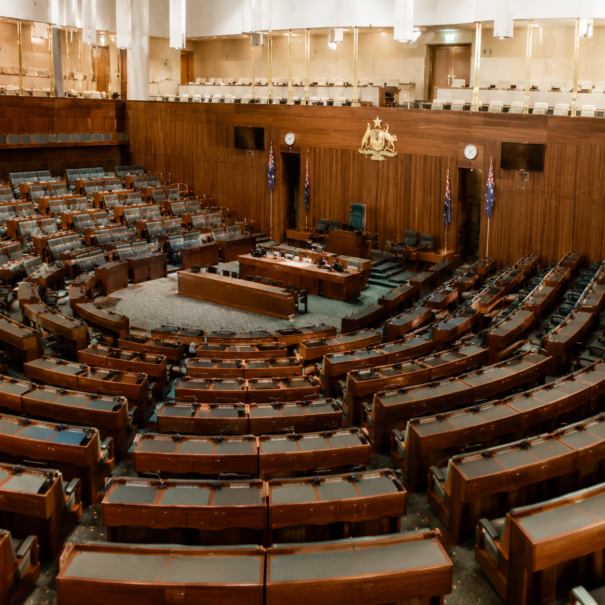
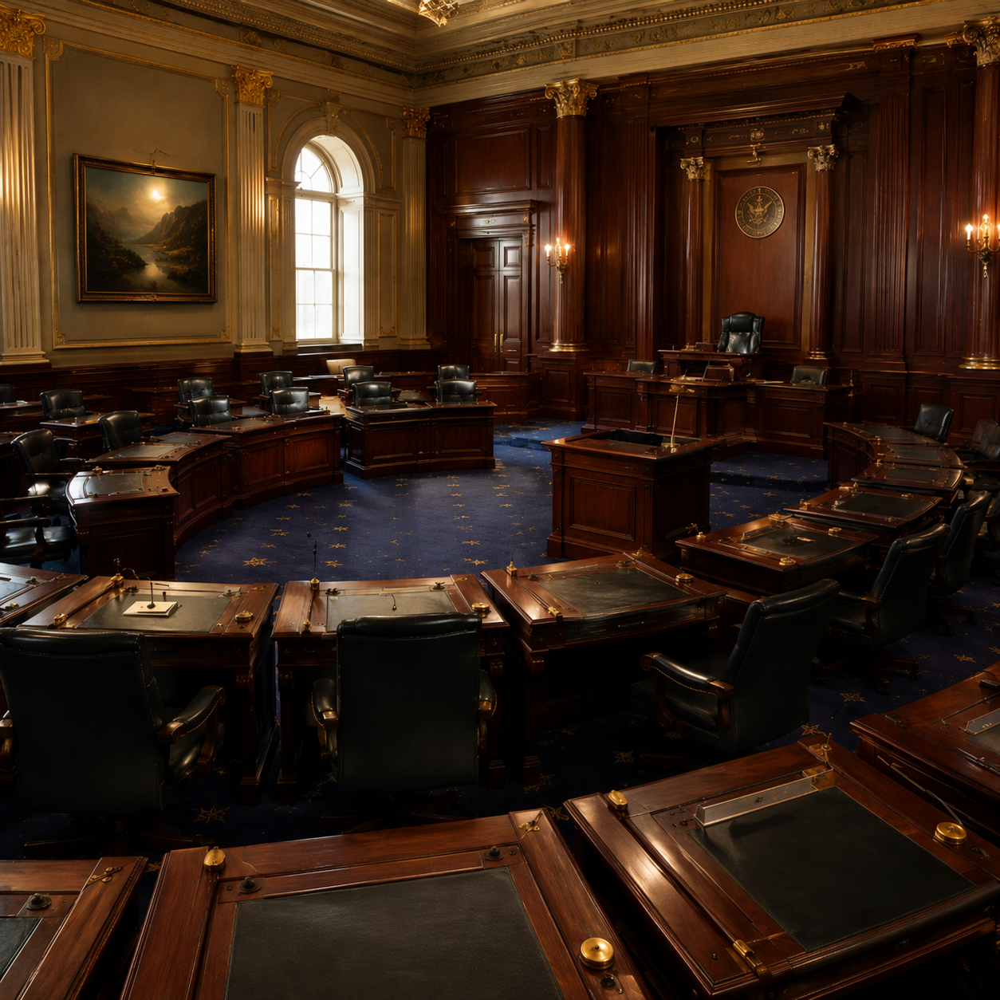
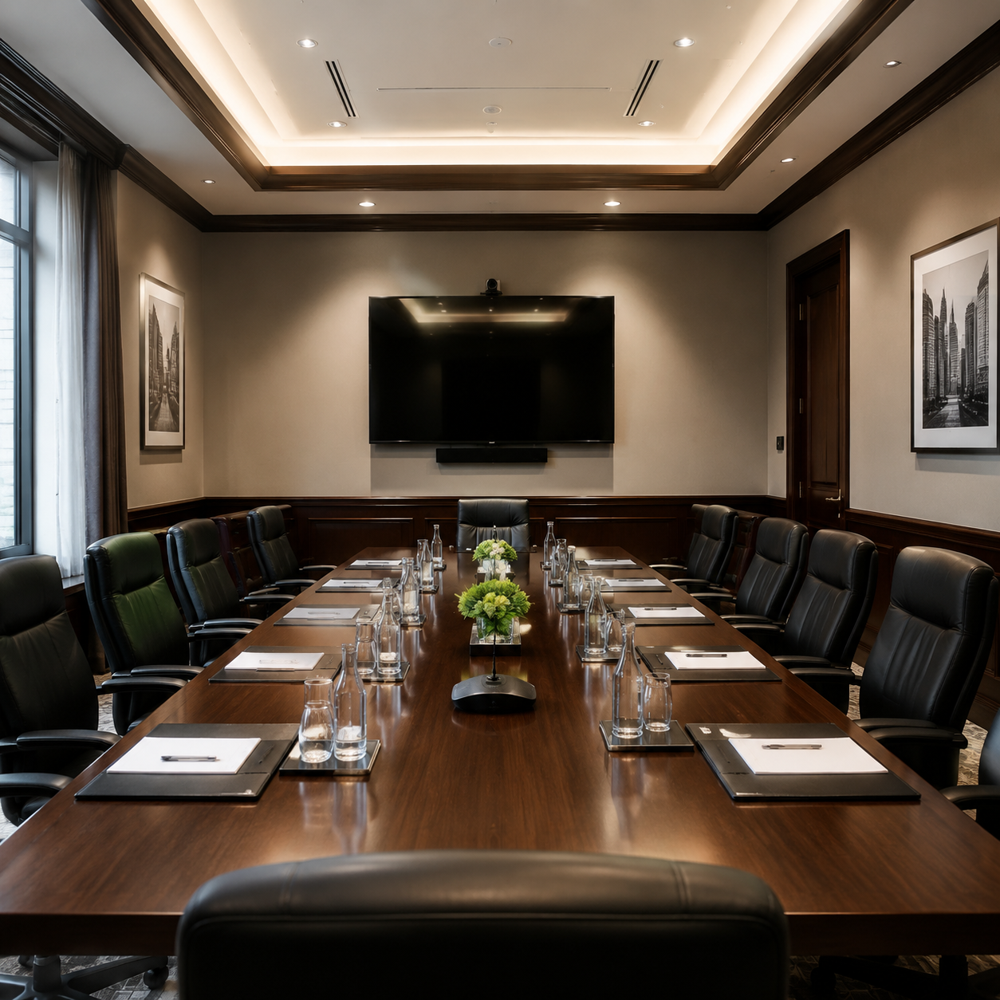
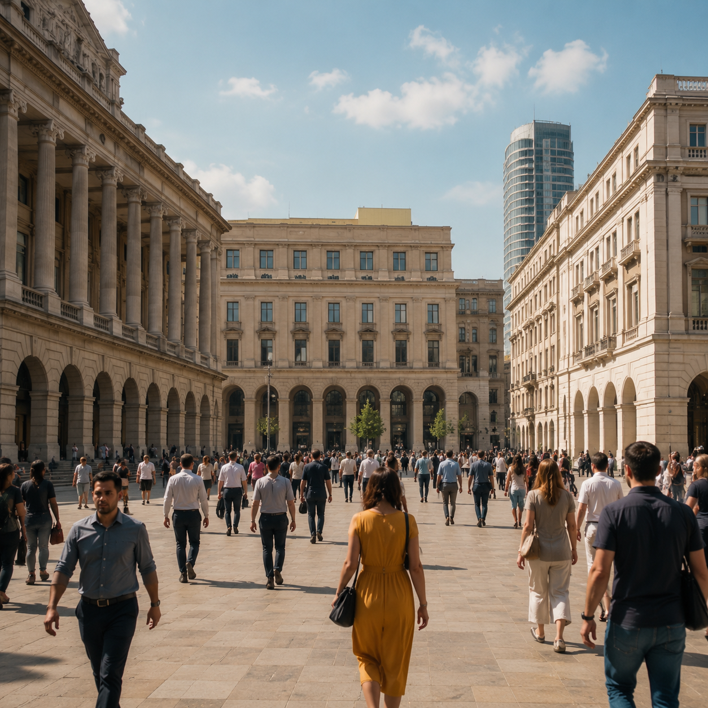
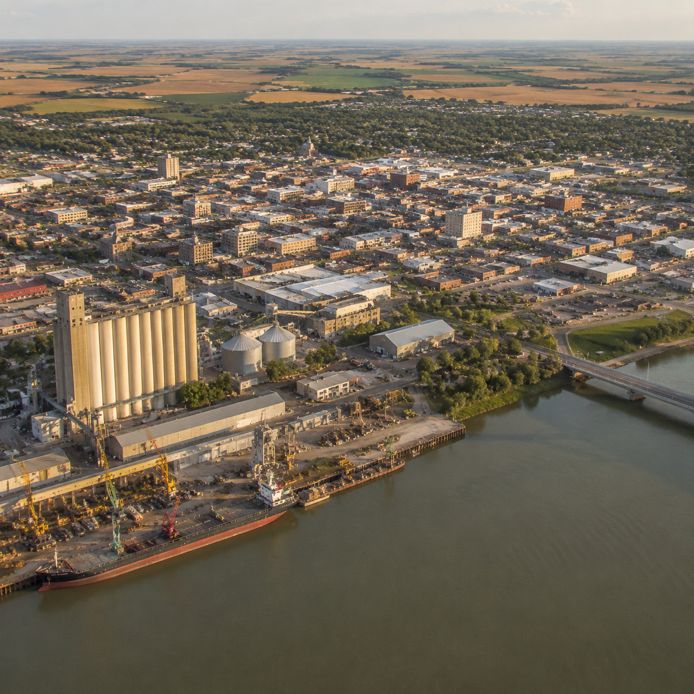
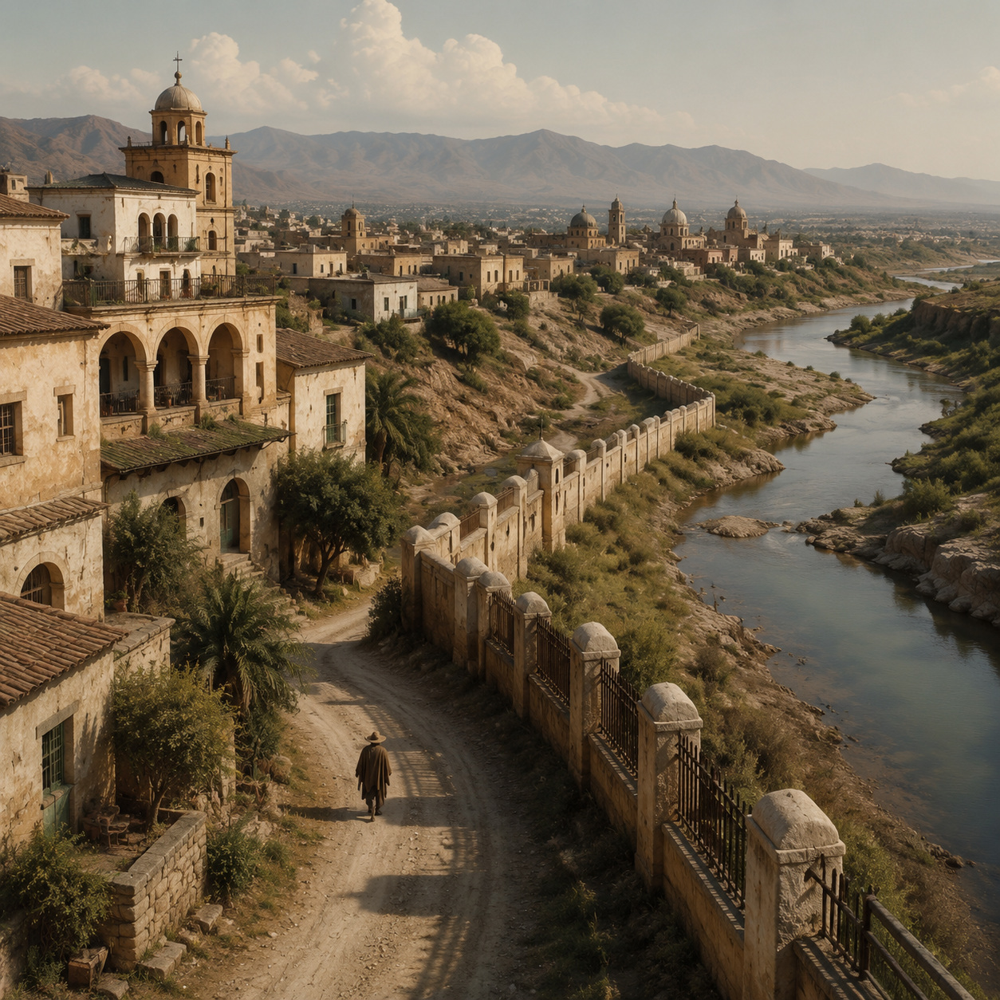
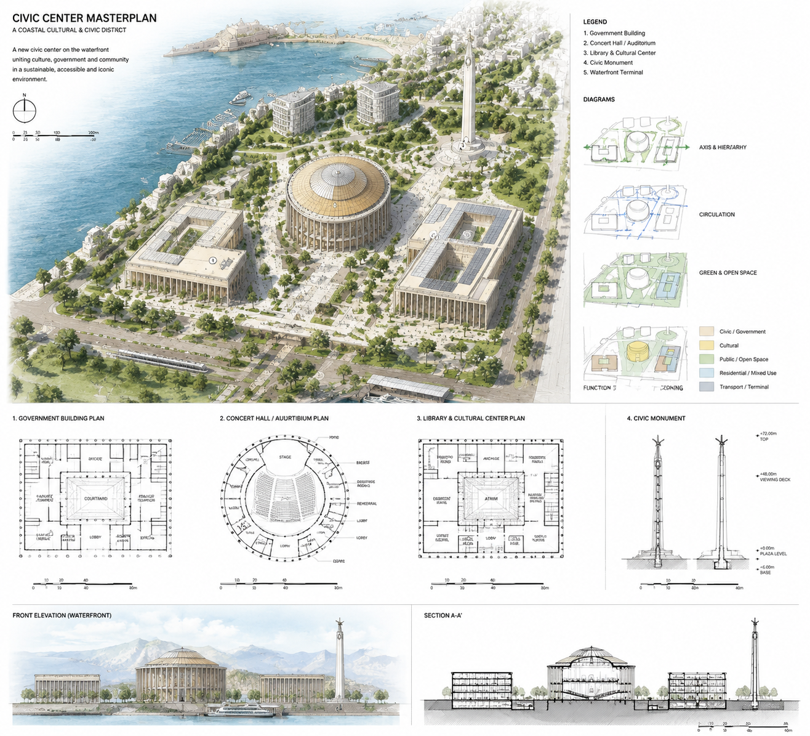
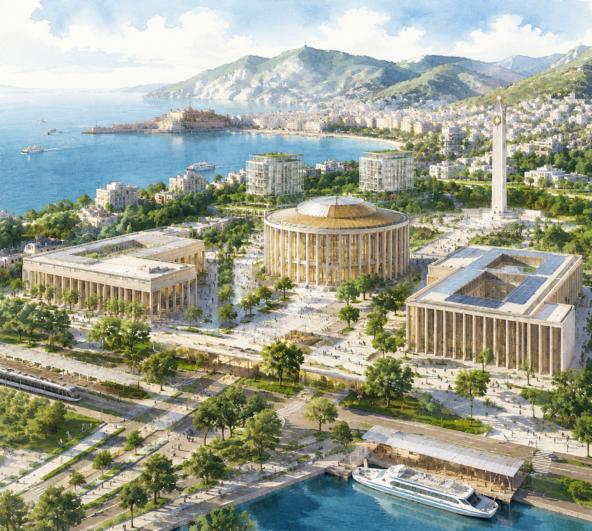
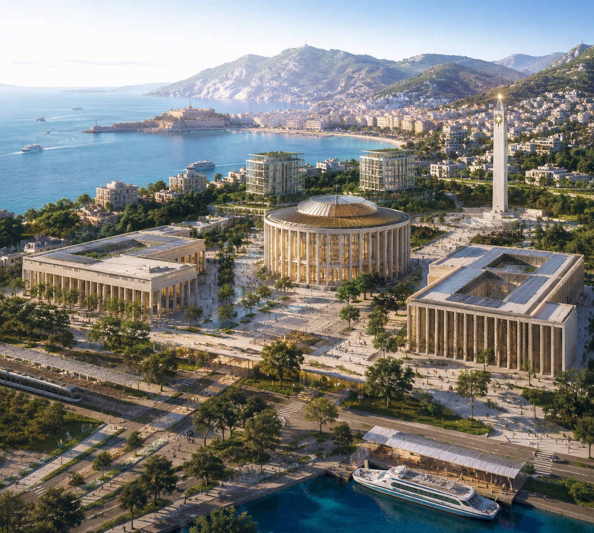

# Torenthia — actual existing image gallery for review

**Status:** visual review aid only · **Date:** 2026-11-22 · **Source:** existing files in `main` Git tree. Images below are **repository files**, not AI-generated substitutes or newly proposed works. The captions are descriptive labels inferred from filenames and **do not verify the depicted contents or canonical status**.

**How to review:** use GitHub's **Preview** / rendered Markdown view. Tap an image to see its original GitHub file. This document intentionally does not add these images to published pages. Return to the [full inventory](MULTIMEDIA-FULL-ASSET-CENSUS-20261122.md) or the [institutions/cityscapes assessment](MULTIMEDIA-INSTITUTIONS-CITYSCAPES-REVIEW-20261122.md).

## Federal institutional imagery

### Assembly chamber — existing master

Repository file: [`images/torenthia-assembly-chamber.png`](../../images/torenthia-assembly-chamber.png).

### Senate chamber — existing master

Repository file: [`images/senate-chamber.png`](../../images/senate-chamber.png).

### Council of Ministers meeting room — institution label needs constitutional verification

Repository file: [`images/council-of-ministers-meetingroom.png`](../../images/council-of-ministers-meetingroom.png).

## Capital and city views

### Terenne civic campus — legacy filename says Verentum (capital-I spelling in `cIvic`)

Repository file: [`images/verentum-cIvic-campus.png`](../../images/verentum-cIvic-campus.png).

### Terenne street-level view — legacy filename says Verentum

Repository file: [`images/verentum-street-level.png`](../../images/verentum-street-level.png).

### Calden cityscape

Repository file: [`images/calden-cityscape.png`](../../images/calden-cityscape.png).

### Dorven cityscape

Repository file: [`images/dorven-cityscape.png`](../../images/dorven-cityscape.png).

### Marisvia cityscape

Repository file: [`images/marisvia-cityscape.png`](../../images/marisvia-cityscape.png).

### Valedon cityscape

Repository file: [`images/valedon-cityscape.png`](../../images/valedon-cityscape.png).

## Ostara civic futures — use with caution

### Ostara civic plan (name only; not an approved present-day building)

Repository file: [`images/ostara-civic-plan.png`](../../images/ostara-civic-plan.png).

### Ostara civic proposal (name only)

Repository file: [`images/ostara-civic-proposal.png`](../../images/ostara-civic-proposal.png).

### Ostara realized concept (do not interpret as canon)

Repository file: [`images/ostara-civic-realized.png`](../../images/ostara-civic-realized.png).

## Review questions

1. **Identity and appropriateness:** Does the image actually match its filename and the intended part of Torenthia?
2. **Purpose:** Does it help distinguish an institution, person or place in the Constitution-in-action world, or merely decorate it?
3. **Status:** Is it a depiction of an existing institution, a planned building, a speculative proposal or an event? Do not represent proposals as current reality.
4. **Placement:** If useful, what one relevant page deserves it? Reuse existing images before creating new artwork.

## Known limitations

- GitHub's image assets are present in the complete recursive `main` tree; this page embeds them relatively from the `docs/torenthia/` folder. Its actual rendering and pixel composition have **not** been independently inspected by the assistant because the available binary API path rejects image bytes.
- Original PNGs are often ~2–3 MiB. This gallery is for review, **not** a production optimization or new image deployment.
- Do not auto-merge the inventory PR or image-reuse PRs, update canon, or publish these images on Torenthia without a separate reviewed change.
